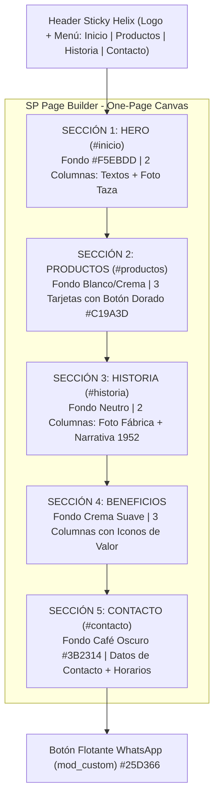

# Estructura de la Landing Page en SP Page Builder

Esta guía describe la configuración técnica paso a paso para maquetar la landing page de **Chocolate Artesanal de Ambato** como una página única (*One-Page Landing*) utilizando **SP Page Builder** en **Joomla 6**.

---

## 1. Configuración General de la Página (Page Settings)

* **Título de la página:** Inicio - Chocolate Artesanal de Ambato
* **Alias:** `inicio`
* **Tipo de Layout:** Boxed / Fluid (Contenedor estándar `container` de 1200px con secciones `fluid` para fondos completos).
* **Integración de Menú (One-Page Scroll):**
  Cada sección principal contiene un identificador único (*Section ID*) que coincide exactamente con los enlaces de navegación del menú superior de Helix Ultimate:
  * `#inicio`
  * `#productos`
  * `#historia`
  * `#contacto`

---

## 2. Desglose Sección por Sección (Filas y Addons)

---

### SECCIÓN 1: HERO (Identificador: `inicio`)

* **Estilo de Fila (Row Settings):**
  * **Color de fondo:** `#F5EBDD` (Crema cálido).
  * **Padding:** Superior `80px`, Inferior `80px` (Desktop) / `40px` y `40px` (Móvil).
  * **Estructura de Columnas:** 2 columnas (`col-lg-7` texto, `col-lg-5` imagen).
* **Columna Izquierda (Contenido y Acciones):**
  1. **Addon Heading:**
     * **Etiqueta HTML:** `<h1>`
     * **Texto:** `Chocolate Artesanal de Ambato`
     * **Color:** `#3B2314` (Café oscuro profundo).
     * **Tipografía:** Serif elegante (Playfair Display / Cormorant Garamond), 46px en Desktop, 32px en Móvil. Peso 700.
  2. **Addon Text Block (Subtítulo):**
     * **Texto:** *"Desde 1952, hecho con cacao ecuatoriano y tradición familiar."*
     * **Color:** `#5A3825` (Tono marrón medio para contraste y legibilidad).
     * **Tipografía:** Sans-serif (Montserrat / Inter), 18px, interlineado 1.6.
  3. **Addon Button Group (2 Botones):**
     * **Botón 1:**
       * **Texto:** `Ver productos`
       * **Enlace:** `#productos`
       * **Estilo:** Fondo café oscuro `#3B2314`, texto color crema `#F5EBDD`, esquinas redondeadas (`border-radius: 6px`), padding `12px 28px`.
       * **Efecto Hover:** Fondo `#4E2F1B`.
     * **Botón 2:**
       * **Texto:** `Nuestra historia`
       * **Enlace:** `#historia`
       * **Estilo:** Fondo transparente, borde sólido de `2px` color dorado `#C19A3D`, texto color café `#3B2314`, padding `10px 26px`.
       * **Efecto Hover:** Fondo `#C19A3D`, texto blanco.
* **Columna Derecha (Media):**
  1. **Addon Image:**
     * **Imagen:** Fotografía en alta resolución de una taza de chocolate caliente espeso con vapor aromático elevándose, espumado tradicionalmente con molinillo.
     * **Formato:** WebP optimizado (máx. 120 KB).
     * **Alt Text:** *"Taza de chocolate caliente artesanal humeante preparado al estilo tradicional de Ambato"*.
     * **Alineación:** Centrada / Derecha con sutil sombra difusa (`box-shadow: 0 15px 30px rgba(59,35,20,0.12)`).

---

### SECCIÓN 2: PRODUCTOS DESTACADOS (Identificador: `productos`)

* **Estilo de Fila:**
  * **Color de fondo:** `#FFFFFF` (Blanco puro para destacar los productos).
  * **Padding:** Superior `90px`, Inferior `90px`.
* **Encabezado de Sección:**
  * **Título (`<h2>`):** `Nuestra Selección de Chocolate Puro` (Color `#3B2314`, Serif).
  * **Subtítulo:** `Granos seleccionados y recetas transmitidas por generaciones.`
* **Estructura de Columnas:** 3 columnas (`col-lg-4 col-md-6 col-12`).
* **Tarjetas de Producto (Addons Image + Text + Button en contenedor Card):**

#### Tarjeta 1:
* **Foto:** Empaque y barra desmoldada de Tableta 70% Cacao fino de aroma.
* **Nombre (`<h3>`):** `Tableta 70% Cacao` (Café `#3B2314`, 22px).
* **Descripción breve:** *Intenso, con notas florales y amargor equilibrado. Ideal para taza o repostería fina.*
* **Precio:** **`$4.50`** (Color `#C19A3D`, 24px, negrita).
* **Botón de Acción:**
  * **Texto:** `Agregar`
  * **Estilo:** Fondo dorado `#C19A3D`, texto blanco, negrita, ancho completo (`width: 100%`).
  * **Enlace:** `https://wa.me/593962660236?text=Hola,%20deseo%20ordenar%20la%20Tableta%2070%25%20Cacao%20($4.50)`

#### Tarjeta 2:
* **Foto:** Barra de chocolate con incrustaciones de cáscara de naranja deshidratada y jengibre fresco molido.
* **Nombre (`<h3>`):** `Naranja & Jengibre` (Café `#3B2314`, 22px).
* **Descripción breve:** *Notas cítricas y toque especiado que potencian la calidez del chocolate ambateño.*
* **Precio:** **`$5.00`** (Color `#C19A3D`, 24px, negrita).
* **Botón de Acción:**
  * **Texto:** `Agregar`
  * **Estilo:** Fondo dorado `#C19A3D`, texto blanco.
  * **Enlace:** `https://wa.me/593962660236?text=Hola,%20deseo%20ordenar%20el%20Chocolate%20Naranja%20y%20Jengibre%20($5.00)`

#### Tarjeta 3:
* **Foto:** Bolsa rústica de papel kraft con granos de cacao tostados a leña en Ambato.
* **Nombre (`<h3>`):** `Cacao en Grano` (Café `#3B2314`, 22px).
* **Descripción breve:** *Grano tostado artesanalmente, listo para infusión, degustación saludable o molienda casera.*
* **Precio:** **`$6.00`** (Color `#C19A3D`, 24px, negrita).
* **Botón de Acción:**
  * **Texto:** `Agregar`
  * **Estilo:** Fondo dorado `#C19A3D`, texto blanco.
  * **Enlace:** `https://wa.me/593962660236?text=Hola,%20deseo%20ordenar%20Cacao%20en%20Grano%20($6.00)`

---

### SECCIÓN 3: HISTORIA Y TRADICIÓN (Identificador: `historia`)

* **Estilo de Fila:**
  * **Color de fondo:** `#FAF5EE` (Crema muy tenue).
  * **Padding:** Superior `85px`, Inferior `85px`.
  * **Estructura de Columnas:** 2 columnas (`col-lg-6` imagen, `col-lg-6` texto).
* **Columna Izquierda (Imagen Artesanal):**
  * **Addon Image:** Fotografía de producción artesanal real (tostado tradicional de cacao en paila, manos expertas seleccionando el grano o fábrica familiar).
  * **Estilo:** Bordes con radio suave (12px), marco decorativo dorado fino.
* **Columna Derecha (Narrativa de Marca):**
  1. **Addon Heading (`<h2>`):**
     * **Texto:** `Desde 1952 en el corazón de Ambato`
     * **Color:** `#3B2314`
  2. **Addon Text Block (Párrafo de Tradición):**
     * **Texto original:**  
       *"Lo que comenzó como una pequeña receta familiar en las faldas del Tungurahua se convirtió en el aroma que despierta los hogares ecuatorianos. Durante más de siete décadas hemos preservado el tostado lento y la molienda a piedra, honrando el verdadero cacao de aroma de nuestra tierra sin aditivos artificiales."*
     * **Color:** `#4A3528`, interlineado 1.7.
  3. **Addon Button:**
     * **Texto:** `Conoce más`
     * **Estilo:** Botón estilo contorno (outline) con borde café `#3B2314`, texto `#3B2314`.
     * **Enlace:** `#contacto` o ventana modal con la cronología histórica completa.

---

### SECCIÓN 4: BENEFICIOS Y VALORES (Identificador: `beneficios`)

* **Estilo de Fila:**
  * **Color de fondo:** `#F5EBDD` (Crema cálido).
  * **Padding:** Superior `60px`, Inferior `60px`.
  * **Estructura de Columnas:** 3 columnas (`col-lg-4 col-md-4 col-12`).
* **Addon Feature Box (x3 elementos):**

1. **Beneficio 1:**
   * **Icono:** Mortero / Manos artesanas (SVG personalizado en color `#C19A3D`).
   * **Título (`<h4>`):** `100% Artesanal`
   * **Descripción:** *Elaborado con procesos ancestrales que conservan intactas las notas organolépticas del cacao puro.*

2. **Beneficio 2:**
   * **Icono:** Hoja natural / Corazón (SVG en color `#C19A3D`).
   * **Título (`<h4>`):** `Beneficios Naturales`
   * **Descripción:** *Rico en antioxidantes, minerales y teobromina que aportan energía saludable sin conservantes químicos.*

3. **Beneficio 3:**
   * **Icono:** Apretón de manos / Balanza justa (SVG en color `#C19A3D`).
   * **Título (`<h4>`):** `Comercio Justo`
   * **Descripción:** *Compramos directamente a familias productoras de cacao fino de aroma, garantizando un pago digno y sostenible.*

---

### SECCIÓN 5: CONTACTO Y PIE DE PÁGINA (Identificador: `contacto`)

* **Estilo de Fila:**
  * **Color de fondo:** `#3B2314` (Café oscuro institucional).
  * **Color de texto:** `#F5EBDD` y `#FFFFFF`.
  * **Padding:** Superior `50px`, Inferior `40px`.
* **Contenido:**
  * **Columna 1:** Logotipo alternativo tipográfico *"Chocolate Artesanal de Ambato - Tradición desde 1952"*.
  * **Columna 2 (Contacto Directo):**
    * Teléfono / WhatsApp: `+593 96 266 0236`
    * Ubicación: Ambato, Provincia de Tungurahua, Ecuador.
    * Envíos a nivel nacional (Quito, Guayaquil, Cuenca y todo el país).
  * **Columna 3 (Horarios y Redes):**
    * Atención al cliente: Lunes a Sábado de 08:30 a 18:00.
    * Iconos de Redes Sociales (Facebook, Instagram, TikTok) con hover dorado `#C19A3D`.
  * **Barra de Copyright:**
    * `© 2026 Chocolate Artesanal de Ambato. Todos los derechos reservados.`

