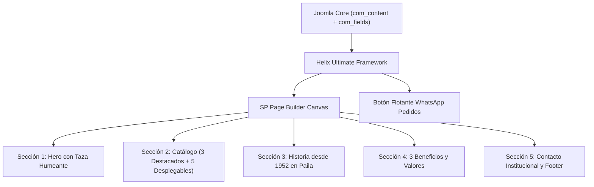

# Estado del Desarrollo y Actualización del Sistema Web

**Proyecto:** Landing Page Comercial y Corporativa - Chocolate Artesanal de Ambato  
**Plataforma:** Joomla! 6 + Helix Ultimate + SP Page Builder  
**Fecha de Actualización:** 13 de Noviembre de 2026  
**Documento Base:** *Tarea 4. 1er avance del proyecto final* (Constante, Masabanda, Tixi, Pullupaxi, Sailema)  

---

## 1. Resumen de Actualizaciones Implementadas

El sistema web ha sido completamente actualizado y alineado con los 5 documentos de especificación técnica y el documento base del proyecto final:

---

## 2. Componentes y Capas Actualizadas

### 2.1. Identidad Visual y Header Sticky (Helix Ultimate)
* **Logotipo Oficial:** Implementado `images/logo_chocolate_ambateno.svg` en formato vectorial escalable con isotipo de mazorca de cacao dorada y tipografía *Playfair Display*.
* **Colores Institucionales:**
  * Fondo de navegación: Crema institucional `#F5EBDD` con efecto blur.
  * Tipografías y títulos: Café oscuro `#3B2314`.
  * Estados hover y acentos: Dorado `#C19A3D`.
* **Top Bar (Barra Superior):**
  * Teléfono / WhatsApp oficial: `+593 96 266 0236`.
  * Correo corporativo: `contacto@chocolateambateno.ec`.
  * Redes sociales verificadas: WhatsApp, Facebook, Instagram (eliminadas redes inactivas o de relleno).
* **Navegación Limpia:**
  * Menú de anclas One-Page: `Inicio (#inicio)`, `Productos (#productos)`, `Historia (#historia)`, `Contacto (#contacto)`.
  * Ocultados botones de inicio de sesión y barra de búsqueda que saturaban la cabecera.

### 2.2. Maquetación en SP Page Builder (`Página #1: Inicio`)
1. **Hero Section (`#inicio`):**
   * Título H1: *"Chocolate Artesanal de Ambato"*.
   * Subtítulo: *"Elaborado con noble cacao ecuatoriano fino de aroma y el calor de nuestra serranía. Puro, aromático y 100% natural."*
   * Botones de llamada a la acción: `Ver productos` (Café institucional) y `Nuestra historia` (Outline dorado).
   * Fotografía en alta resolución: `images/hero_chocolate_taza.webp` (Taza humeante artesanal con espuma de molinillo, granos de cacao y canela).
2. **Sección Productos (`#productos`):**
   * **3 Productos Destacados en Vista Principal:**
     1. Tableta 70% Cacao Fino de Aroma ($4.50).
     2. Chocolate con Naranja & Jengibre ($5.00).
     3. Cacao en Grano Tostado en Paila ($6.00).
   * **Catálogo Completo Interactivo:** Botón desplegable que revela las 5 especialidades adicionales:
     4. Pasta Tradicional de Chocolate de Taza ($4.00).
     5. Chocolate con Almendras Tostadas y Sal Marina ($5.50).
     6. Cacao Puro en Polvo Desgrasado ($4.80).
     7. Bombones Rellenos de Frutas Andinas ($7.50).
     8. Nibs de Cacao Caramelizados con Panela ($4.00).
   * Enlaces directos a WhatsApp Click-to-Chat con mensaje prellenado por producto.
3. **Sección Historia (`#historia`):**
   * Fotografía de tradición: `images/historia_paila_artesanal.webp` (Artesano tostando cacao en paila de cobre tradicional de Ambato sobre fuego de leña).
   * Narrativa de marca que destaca la herencia desde 1952, la molienda a piedra y el orgullo tungurahuense.
4. **Sección Beneficios y Valores (`#beneficios`):**
   * 3 tarjetas con iconos SVG dorados:
     * *100% Artesanal*: Procesos ancestrales en paila de cobre.
     * *Beneficios Naturales*: Rico en antioxidantes, magnesio y teobromina.
     * *Comercio Justo*: Pago digno a familias productoras de cacao fino de aroma.
5. **Sección Contacto y Pie de Página (`#contacto`):**
   * Columna de marca y lema tradicional.
   * Información directa: Dirección en Ambato, Tungurahua, envíos a nivel nacional, teléfono y enlace directo a WhatsApp.
   * Horarios de atención y aviso de copyright © 2026.

### 2.3. Joomla Core (`com_content` y `com_fields`)
* **Categoría Creada:** `Especialidades de Cacao` (ID #8, alias `especialidades-cacao`), asignada a los 8 artículos de producto.
* **Grupo de Campos:** `Ficha del Producto` (ID #1).
* **Campos Personalizados Activos:**
  * `precio_producto` (ID #1, Texto) -> Precios de $4.00 a $7.50.
  * `presentacion_cacao` (ID #2, Texto) -> Gramajes y porcentajes (100g, 250g, 120g, etc.).
  * `origen_grano` (ID #3, Texto) -> Procedencia del cacao y notas de cata.
* **Asociaciones de Flujo de Trabajo:** Vinculados al flujo de publicación nativo de Joomla.

### 2.4. Módulos y Estilos CSS
* **Botón Flotante de WhatsApp:** Módulo nativo `mod_custom` posicionado en `debug`, con animación de pulso, icono SVG oficial y número de atención (+593 96 266 0236).
* **Estilos `custom.css`:**
  * Importación de fuentes tipográficas Google Fonts (*Playfair Display* y *Montserrat*).
  * Eliminación de títulos de fila redundantes de SP Page Builder (`.sppb-section-title`).
  * Estilos de elevación y hover para tarjetas de producto y botones.

---

## 3. URLs de Verificación Local

| Página / Recurso | URL Local | Estado |
| :--- | :--- | :---: |
| **Sitio Web Principal (Landing)** | [http://localhost/joomla/](http://localhost/joomla/) | Activo (HTTP 200) |
| **Panel de Administración** | [http://localhost/joomla/administrator](http://localhost/joomla/administrator) | Activo |
| **Catálogo en Contenido** | `administrator/index.php?option=com_content&view=articles` | 8 Artículos |
| **Campos Personalizados** | `administrator/index.php?option=com_fields&context=com_content.article` | 3 Campos |

