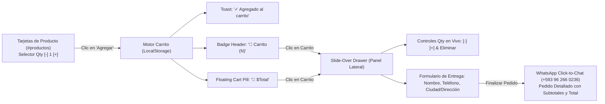

# Sistema de Carrito de Compras y Pedidos Directos

**Proyecto:** Landing Page Comercial y Corporativa - Chocolate Artesanal de Ambato  
**Plataforma:** Joomla! 6 + Helix Ultimate + Vanilla JS & CSS Modules  
**Fecha de Implementación:** 13 de Noviembre de 2026  
**Documento Base:** *Tarea 4. 1er avance del proyecto final* (Constante, Masabanda, Tixi, Pullupaxi, Sailema - Requerimiento de Carrito de Compras)

---

## 1. Arquitectura y Funcionamiento del Carrito

Para mantener la máxima velocidad de carga (sin sobrecargar el CMS con suites pesadas como Virtuemart o Hikashop) y priorizar la conversión rápida por WhatsApp según lo estipulado en el documento base, se implementó un **motor de carrito de compras reactivo en Vanilla JS y LocalStorage**, integrado a Joomla a través de `mod_custom` y estilos globales en Helix Ultimate.



---

## 2. Componentes del Sistema

### 2.1. Controles en las Tarjetas de Producto
Cada una de las 8 especialidades de chocolate cuenta con:
* **Selector de Cantidad Stepper:** Botones decremento `-`, input numérico readonly e incremento `+`.
* **Botón `Agregar` Dorado:** Atributos de datos semánticos (`data-id`, `data-name`, `data-price`, `data-img`, `data-presentation`).
* **Enlace Secundario:** Opción de compra rápida individual directa a WhatsApp.

### 2.2. Panel Lateral Deslizante (Slide-Over Drawer)
* Ancho de 440px (adaptable a pantallas móviles).
* Fondo oscuro con desenfoque (*backdrop blur*) al abrirse.
* Bloqueo automático del scroll de la página mientras el carrito está abierto.
* **Estado Vacío:** Ilustración amigable con llamada a la acción para explorar especialidades.
* **Lista de Artículos:**
  * Miniatura del producto.
  * Título y gramaje/presentación.
  * Controles de cantidad en vivo `[-] Qty [+]` (recalcula instantáneamente el total sin recargar la página).
  * Botón de eliminación directa (icono de papelera).
* **Bloque de Resumen:** Subtotal, nota de envíos y Total destacado en dorado.

### 2.3. Formulario de Datos y Checkout WhatsApp
* Campos requeridos para coordinar la entrega:
  1. *Nombre y Apellido*
  2. *Teléfono / WhatsApp*
  3. *Ciudad y Dirección de Entrega*
  4. *Notas Especiales* (opcional: envolturas para regalo, referencias, etc.)
* **Generador de Mensaje de Pedido:**
  Compila automáticamente el pedido con formato estructurado:
  ```text
  🍫 *NUEVO PEDIDO - CHOCOLATE AMBATEÑO*
  -----------------------------------------
  👤 *Cliente:* [Nombre del Cliente]
  📱 *Teléfono:* [Teléfono]
  📍 *Ciudad / Dirección:* [Dirección]
  📝 *Notas:* [Notas opcionales]
  -----------------------------------------
  📦 *DETALLE DE PRODUCTOS:*
  • 2x Tableta 70% Cacao (100g • 70% Cacao) - $9.00
  • 1x Cacao en Grano Tostado (250g • 100% Cacao) - $6.00
  -----------------------------------------
  💰 *TOTAL A PAGAR:* $15.00 USD
  -----------------------------------------
  _Pedido realizado desde la web oficial de Chocolate Artesanal de Ambato._
  ```

### 2.4. Notificaciones y Persistencia
* **Notificación Toast:** Aparece en la esquina superior derecha cada vez que el usuario añade un producto, confirmando cantidad y nombre.
* **Persistencia:** Almacenado en `localStorage` bajo la clave `chocolate_ambato_cart`. Los productos permanecen guardados aunque el usuario cierre la pestaña o recargue el navegador.

---

## 3. Configuración en Joomla

* **Módulo de Carrito:**
  * Componente: `mod_custom` (ID #112).
  * Posición: `debug` (carga global en todas las páginas del sitio).
  * Estado: Publicado y asignado a `menuid = 0` (todas las páginas).
* **Inyección en Cabecera:**
  * Inyectado dinámicamente en `#sp-menu` junto al menú principal y el botón móvil offcanvas.
* **Estilos CSS:**
  * Compilados en [custom.css](file:///opt/lampp/htdocs/joomla/templates/shaper_helixultimate/css/custom.css).

